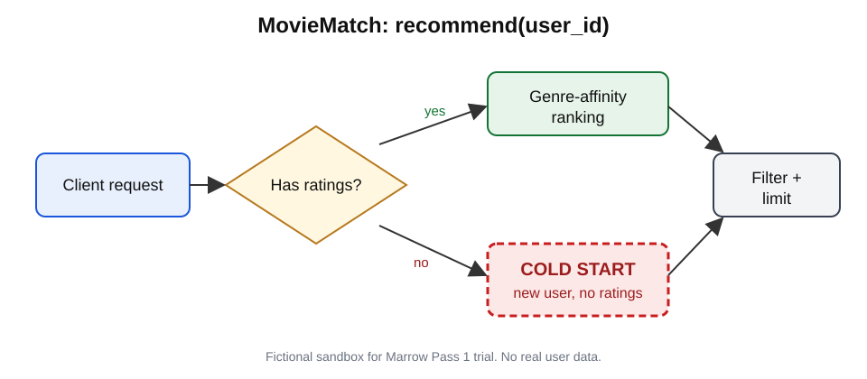

# MovieMatch recommendation flow

1. The client calls `recommend(user_id, limit, genre)`.
2. **Has ratings?** A user with ratings goes to genre-affinity ranking.
3. **No ratings (new user)** goes to the box marked *Cold start*. Its behaviour
   is a product decision for the v1 review meeting.
4. Ranked titles are filtered (already rated, genre) and limited.
